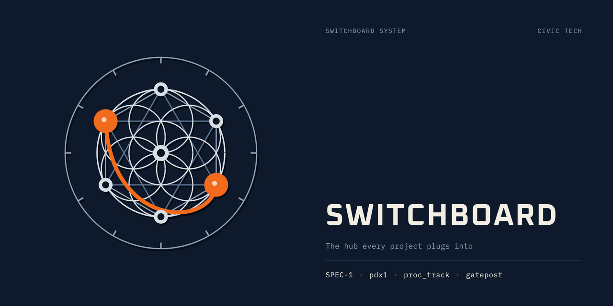

# [switchboard]

An interactive demo of SWITCHBOARD, the operator's board over the CLS-1000 systems, and the SPEC-1 desks behind it.

**[▶ Open the live demo](https://cls-1000.github.io/github/)** · [Logo gallery](https://cls-1000.github.io/github/gallery.html) · [Triage Desk](https://cls-1000.github.io/github/triage.html) · [MCP Console](https://cls-1000.github.io/github/mcp.html)

**Everything here runs on sample data.** The runs, records, briefs and signals are illustrative, except the Brief Archive and Sample Brief, which are archived output of real cycles. Nothing in this demo is live, and nothing is published from it.

## Pages

| Page | What it shows |
| --- | --- |
| [`index.html`](index.html) | SWITCHBOARD: one panel per system, with a lamp for each line's state |
| [`gallery.html`](gallery.html) | SWITCHBOARD logo family gallery, including the CLS foundation mark, project logos, sacred-geometry variations, animated intros, The Sentinel finale and a repo-data card |
| [`triage.html`](triage.html) | Triage Desk: cycle runs, the gate funnel, and each record's provenance |
| [`legislative.html`](legislative.html) | Legislative Desk: Oregon measures, interim hearings and the desk brief |
| [`narrative.html`](narrative.html) | Narrative Desk: drafts in the editorial-proof layout, and release behind the publish guard |
| [`briefs/index.html`](briefs/index.html) | Brief Archive: 22 daily briefs from real SPEC-1 cycles, model-written (April 2026) and rule-based (October 2026), each with a note on where it came from. Sources in [`samples/`](samples/) |
| [`sample-brief.html`](sample-brief.html) | Sample Brief: the archived April 24, 2026 SPEC-1 daily brief (a real cycle's output, kept as the reference example of the house format). Source: [`samples/spec1-brief-2026-04-24.md`](samples/spec1-brief-2026-04-24.md) |
| [`mcp.html`](mcp.html) | MCP Console: the tools SPEC-1 exposes to Claude |
| [`citizen.html`](citizen.html) | Citizen Cognisance: a map of documented ties in Portland's political ecosystem |

The logo gallery's accent color defaults to signal orange (`#F26A1B`). Use its swatches to switch colors, or add `?accent=<hex>` to the gallery or any page under `brand/`, e.g. `brand/switchboard.html?accent=3FB6A8`.

## Viewing it

Open `index.html` in a browser, or use the GitHub Pages site: https://cls-1000.github.io/github/

## Rights

All rights reserved. This demo is shared for viewing only. It is not open source, and no license to copy, modify or redistribute it is granted.

Corrections and questions are welcome as issues. Pull requests are not accepted.
